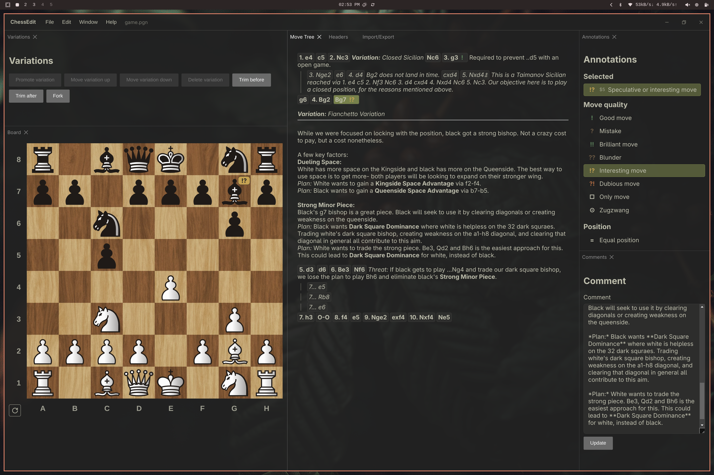

# ChessEdit

ChessEdit is a desktop app for studying and annotating chess games.

  

## Make it yours

Open **Edit → Theme…** to personalize the app. Everything applies live:

- **Theme** — the overall look of the app (light, dark, and plenty of colors in between). You can add your own: the "Add themes…" button opens a folder where each file becomes a theme.
- **Board theme** — 25+ boards, from classic brown and plain colors to wood, marble, and metal textures from lichess.org.
- **Piece theme** — 40+ piece sets, from the classic Staunton-style set to playful ones from lichess.org.
- **Background transparency** — how much the window shows through.

## For developers

The repository has two workspace packages:

- `packages/chessboard/` — React chess components (board, move tree, PGN editors), imported by the app as `chessboard`
- `apps/desktop/` — the Electron app shell (native file open/save via IPC, React UI)

Board and piece themes are generated from [lichess](https://lichess.org)'s public asset collection.
